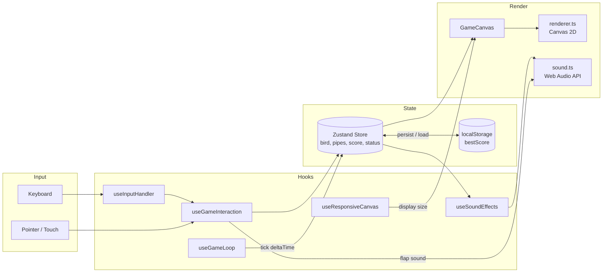

# Flappy Bird — Step-by-Step Build Guide

> **Archived: original build playbook.** This document is the original roadmap used to build the Flappy Bird game from an empty folder to a deployable single-page app. It is intentionally framed as a "making-of" narrative: the codebase may have evolved since the guide was written, so treat the steps as the intended construction order rather than a literal description of the current source. For current setup, architecture, and deployment notes, see [../README.md](../README.md).

---

> **Project Summary:** Flappy Bird is a client-only arcade game built on HTML5 Canvas. The player taps, clicks, or presses a key to flap a procedurally drawn bird through an endless stream of gap-bearing pipes. All game state (bird physics, pipe positions, score, status) lives in a single Zustand store, while a delta-time `requestAnimationFrame` loop keeps physics consistent across 60Hz–144Hz displays. Visuals are drawn entirely in code (gradients, sprites, scrolling ground) with no image assets, and sound effects are synthesized on the fly with the Web Audio API, so the game ships with zero binary media. Best score is persisted in `localStorage`, the layout is fully responsive with DPR-aware rendering, and the UI is accessible via ARIA labels and full keyboard support. Stack: React 19, TypeScript 5, Vite 6, Zustand 5, React Router 7, Tailwind CSS 3.

Each step below is a self-contained prompt. Execute them in order.

Stack: React 19, TypeScript 5, Vite 6, Zustand 5, React Router 7, Tailwind CSS 3, HTML5 Canvas, Web Audio API.

---

## Table of Contents

**PHASE 1 — Project Foundation**

- STEP 1 — Project Scaffolding & Dependency Setup
- STEP 2 — Tooling Configuration (Vite, TypeScript, Tailwind, PostCSS)
- STEP 3 — Game Constants & Type Definitions

**PHASE 2 — Game Core**

- STEP 4 — Zustand Game Store (state shape & lifecycle actions)
- STEP 5 — Bird Physics, Dynamic Difficulty & Collision Detection
- STEP 6 — Frame-Rate Independent Game Loop Hook

**PHASE 3 — Rendering & Audio**

- STEP 7 — Canvas Renderer (background, pipes, ground, bird, score)
- STEP 8 — Procedural Sound Engine (Web Audio API)

**PHASE 4 — UI, Hooks & Pages**

- STEP 9 — GameCanvas Component (DPR-aware rendering)
- STEP 10 — Input, Sound-Effect & Responsive Hooks
- STEP 11 — Overlays, Sound Toggle & GamePage Composition
- STEP 12 — App Routing & Entry Point

**PHASE 5 — Polish & Deploy**

- STEP 13 — Global Styles, Animations & Fonts
- STEP 14 — Accessibility, Responsiveness & Performance Pass
- STEP 15 — Build, Documentation & Deployment

**Appendices**

- Appendix A — Shared Constants Reference
- Appendix B — Common Patterns
- Appendix C — Pre-Flight Checklist
- Appendix D — Common Pitfalls

---

## Global Build Rules (apply to EVERY step)

- **No git operations.** Do not run `git init`, `add`, `commit`, `push`, branch, or tag commands. Version control is handled manually by the user.
- **No unapproved packages.** Only install the dependencies listed in this guide. Prefer native browser APIs (Canvas 2D, Web Audio, `localStorage`, `ResizeObserver`, `requestAnimationFrame`) over third-party libraries.
- **No long-running processes** (dev server, watchers, builds) unless the user explicitly asks for them.
- **Treat every step as self-contained.** A step lists its goal, the files it creates or edits, any new dependency, implementation notes, and an acceptance checklist. Do not assume context beyond what previous steps produced.
- **Code quality.** Clean, readable, modern TypeScript. ES6+, React Hooks, `camelCase` identifiers, English names. Apply DRY: shared logic goes in one place.
- **Non-functional priorities.** Security, accessibility (a11y), and performance are always first-class concerns.

---

## Architecture at a Glance

This is a client-only application; there is no backend, database, or network layer. The data flows in a single direction: input → store → render.

Key relationships:

- **Store is the single source of truth.** Components subscribe to slices; the game loop drives `tick`.
- **Rendering is a pure projection of state.** `renderer.ts` functions take state and a context; they hold no state themselves.
- **Audio is decoupled.** A singleton `soundEngine` is triggered reactively (score/hit/swoosh) and imperatively (flap, for zero latency).
- **Responsiveness is handled with `ResizeObserver`,** and the canvas pixel buffer is scaled by `devicePixelRatio` for crisp output.

---

# PHASE 1 — PROJECT FOUNDATION

---

## STEP 1 — Project Scaffolding & Dependency Setup

**Goal:** Create a Vite + React + TypeScript project skeleton with the exact runtime and dev dependencies the game needs.

**Files/folders to create or edit:**

- `package.json`
- `index.html`
- `src/main.tsx` (placeholder for now)
- `.gitignore`

**Required dependencies:**

- Runtime: `react`, `react-dom`, `react-router-dom`, `zustand`
- Dev: `typescript`, `vite`, `@vitejs/plugin-react`, `@types/react`, `@types/react-dom`, `tailwindcss`, `postcss`, `autoprefixer`

**Implementation notes:**

- Set `"type": "module"` and `"private": true` in `package.json`.
- Define scripts:
  - `"dev": "vite"`
  - `"build": "tsc -b && vite build"`
  - `"preview": "vite preview"`
- `index.html` includes a `#root` div, loads `/src/main.tsx` as a module, and links the "Press Start 2P" Google Font for the retro look.
- Add a `<meta name="description">` for SEO.

**Acceptance checklist:**

- [ ] `package.json` lists all dependencies above with sensible version ranges.
- [ ] `index.html` has `#root` and the module script tag.
- [ ] Running `npm install` succeeds (only when the user requests it).

---

## STEP 2 — Tooling Configuration (Vite, TypeScript, Tailwind, PostCSS)

**Goal:** Configure the build chain so the dev server, type checker, and Tailwind pipeline all work together.

**Files/folders to create or edit:**

- `vite.config.ts`
- `tsconfig.json`, `tsconfig.app.json`
- `tailwind.config.js`
- `postcss.config.js`

**Implementation notes:**

- `vite.config.ts`: register `@vitejs/plugin-react`; set `server.port = 3000` and `server.open = true`; build to `dist` with `sourcemap: false`.
- TypeScript: strict mode on. Use a solution-style `tsconfig.json` that references `tsconfig.app.json`.
- `tailwind.config.js`: set `content` to `./index.html` and `./src/**/*.{js,ts,jsx,tsx}`. Extend the theme with a `game` font family (`"Press Start 2P"`), custom game colors, and two animations (`bounce-slow`, `pulse-fast`).
- `postcss.config.js`: enable `tailwindcss` and `autoprefixer`.

**Acceptance checklist:**

- [ ] `npm run dev` would serve on port 3000 and auto-open.
- [ ] Tailwind classes are picked up from `src` and `index.html`.
- [ ] `tsc -b` reports no errors on an empty project.

---

## STEP 3 — Game Constants & Type Definitions

**Goal:** Centralize all tunable numbers and define the TypeScript contracts for game entities. This is the foundation every later module imports.

**Files/folders to create or edit:**

- `src/constants/game.ts`
- `src/types/game.ts`

**Implementation notes:**

- `constants/game.ts` exports `as const` objects: `CANVAS_WIDTH` (400), `CANVAS_HEIGHT` (600), `TARGET_FRAME_MS` (`1000 / 60`), and grouped configs `BIRD`, `PIPE`, `GROUND`, `SCORE`, `COLORS`.
  - `BIRD`: start position, size, `gravity`, `flapPower`, `maxVelocity`, rotation limits.
  - `PIPE`: `width`, `gap`, base `speed`, `speedIncrement`, `scoreInterval`, `maxSpeed`, `spacing`, height bounds, cap dimensions.
  - `COLORS`: all canvas fill/stroke colors so theming happens in one place.
- `types/game.ts` defines `Bird`, `PipePair`, `GameStatus` (`"idle" | "playing" | "gameOver"`), `GameState`, and `GameActions` interfaces.

**Implementation notes (why):** Keeping physics constants in one `as const` module means difficulty tuning never requires touching logic, and the literal types flow into the store for free.

**Acceptance checklist:**

- [ ] All constants are typed `as const` and documented with short comments.
- [ ] `GameState` and `GameActions` cover status, score, bestScore, bird, pipes, groundOffset, and every action used later.

---

# PHASE 2 — GAME CORE

---

## STEP 4 — Zustand Game Store (state shape & lifecycle actions)

**Goal:** Build the single source of truth: initial state, `localStorage` persistence, and the lifecycle actions `startGame`, `flap`, `reset`.

**Files/folders to create or edit:**

- `src/store/useGameStore.ts`

**Implementation notes:**

- Use `create<GameState & GameActions>()`.
- `loadBestScore` / `saveBestScore` wrap `localStorage` access in `try/catch` so private-mode or quota failures never crash the game.
- `createInitialState()` factory returns a fresh idle state with `bestScore` loaded from storage.
- `startGame` seeds three pipe pairs spaced by `PIPE.spacing`, resets the bird, and sets `status: "playing"`.
- `flap` is a no-op unless `status === "playing"`; it applies `BIRD.flapPower` and the upward rotation.
- `reset` returns to idle while preserving the loaded best score.

**Acceptance checklist:**

- [ ] Best score survives a page reload.
- [ ] `flap` only affects the bird while playing.
- [ ] `startGame` always produces a deterministic, playable starting layout.

---

## STEP 5 — Bird Physics, Dynamic Difficulty & Collision Detection

**Goal:** Implement the per-frame simulation inside the store's `tick` action, including gravity, smooth rotation, pipe scrolling, scoring, speed ramp-up, and collisions.

**Files/folders to create or edit:**

- `src/store/useGameStore.ts` (add `tick`, `generatePipeHeight`, `createPipePair`, `getCurrentSpeed`, `checkCollision`)

**Implementation notes:**

- **Delta normalization:** `const dt = Math.min(deltaTime, 33.33) / TARGET_FRAME_MS;`. Clamping to 33.33ms avoids huge physics jumps after a tab switch; dividing by the 60fps frame time makes all constants frame-rate independent.
- **Gravity & velocity:** clamp velocity to `BIRD.maxVelocity`; advance `y` by `velocity * dt`.
- **Rotation:** lerp toward a target angle derived from velocity using `1 - Math.pow(0.15, dt)` so smoothing is also frame-rate independent.
- **Pipes:** move each pipe left by `getCurrentSpeed(score) * dt`; mark `passed` and increment score when a pipe clears the bird; drop off-screen pipes; append a new pair when the last one moves far enough in.
- **Dynamic difficulty:** `getCurrentSpeed` adds `speedIncrement` per `scoreInterval` tier, capped at `maxSpeed`.
- **Collision:** AABB checks against ceiling, ground (`GROUND.y`), and both pipe segments. On collision, persist best score and set `status: "gameOver"`.

**Implementation notes (why):** Running collision on the *post-update* temp state ensures the frame that causes a crash is detected immediately rather than one frame late.

**Acceptance checklist:**

- [ ] Game feels identical on 60Hz and 144Hz monitors.
- [ ] Score increments exactly once per passed pipe.
- [ ] Speed increases gradually and never exceeds `PIPE.maxSpeed`.
- [ ] Hitting a pipe, the ground, or the ceiling ends the game.

---

## STEP 6 — Frame-Rate Independent Game Loop Hook

**Goal:** Provide a reusable `requestAnimationFrame` loop that delivers a capped delta time to a callback and starts/stops cleanly.

**Files/folders to create or edit:**

- `src/hooks/useGameLoop.ts`

**Implementation notes:**

- Signature: `useGameLoop(callback: (deltaTime: number) => void, isRunning: boolean)`.
- Store the callback in a ref so the rAF effect does not re-subscribe on every render.
- On each frame compute `deltaTime` from timestamps, cap it at 33.33ms, and call the latest callback.
- Cancel the animation frame in the effect cleanup and when `isRunning` flips to false.

**Acceptance checklist:**

- [ ] Loop runs only while `isRunning` is true.
- [ ] No stale-closure bugs when the callback changes between renders.
- [ ] No leaked animation frames after unmount.

---

# PHASE 3 — RENDERING & AUDIO

---

## STEP 7 — Canvas Renderer (background, pipes, ground, bird, score)

**Goal:** Draw the entire game procedurally — no image assets — using small, pure functions that accept a `CanvasRenderingContext2D`.

**Files/folders to create or edit:**

- `src/engine/renderer.ts`

**Implementation notes:**

- Export `clearCanvas`, `drawBackground`, `drawPipes`, `drawGround`, `drawBird`, `drawScore`, `drawIdleBird`.
- All drawing uses game coordinates (400×600); the caller applies the scale transform (see STEP 9).
- **Background:** vertical sky gradient.
- **Pipes:** body gradient + cap with overhang and border stroke, drawn for both top and bottom segments around `PIPE.gap`.
- **Ground:** gradient fill plus a scrolling dashed line driven by `lineDashOffset`.
- **Bird:** `ctx.save()` → translate to center → rotate by `bird.rotation` → draw ellipse body, animated wing (`Math.sin(flapFrame * 0.5)`), eye, pupil, and triangular beak → `ctx.restore()`.
- **Score:** retro pixel font with a shadow offset.
- **Idle bird:** floats with `Math.sin(frame * 0.05)` and reuses `drawBird`.

**Implementation notes (why):** Keeping renderer functions pure and stateless makes them trivially testable and lets `GameCanvas` decide *when* to draw without the renderer caring about *what state* drives it.

**Acceptance checklist:**

- [ ] No external image or sprite files are referenced.
- [ ] Bird rotation pivots around its center.
- [ ] Ground dashes scroll smoothly in sync with pipe speed.

---

## STEP 8 — Procedural Sound Engine (Web Audio API)

**Goal:** Generate retro sound effects at runtime so the game ships with zero audio files, respecting browser autoplay policy.

**Files/folders to create or edit:**

- `src/engine/sound.ts`

**Implementation notes:**

- Export a singleton `soundEngine` (instance of a `SoundEngine` class) and a `SoundName` union: `"flap" | "score" | "hit" | "swoosh"`.
- Lazily create/resume the `AudioContext` in `getContext()` so it is only constructed after a user gesture.
- `play(name)` is a no-op when muted and wraps generation in `try/catch` to swallow audio errors silently.
- Sound recipes:
  - **flap:** short sine sweep 400→600 Hz with fast decay.
  - **score:** two ascending square-wave beeps (880 Hz then 1320 Hz).
  - **hit:** low sine thump (150→40 Hz) layered with a white-noise burst.
  - **swoosh:** band-pass filtered white noise with a frequency sweep.
- Expose `toggle()` and `isEnabled()` for the mute control.

**Acceptance checklist:**

- [ ] No `.mp3`/`.wav` assets are loaded.
- [ ] First sound only plays after a user interaction (no autoplay warnings).
- [ ] `toggle()` cleanly mutes/unmutes all effects.

---

# PHASE 4 — UI, HOOKS & PAGES

---

## STEP 9 — GameCanvas Component (DPR-aware rendering)

**Goal:** Render the game to a `<canvas>` that stays crisp on high-DPI screens and animates in every game state.

**Files/folders to create or edit:**

- `src/components/GameCanvas.tsx`

**Implementation notes:**

- Subscribe to `status`, `bird`, `pipes`, `groundOffset`, `score`, and `tick` from the store.
- Use a `ResizeObserver` to sync the canvas pixel buffer to `cssSize * devicePixelRatio`, updating only when dimensions actually change.
- A memoized `render(deltaTime)` accumulates animation time, computes a 60fps-equivalent frame for wing flap, applies a single `setTransform` from game coordinates to buffer size, then calls the renderer functions in order.
- Drive physics with `useGameLoop(gameStep, status === "playing")`, where `gameStep` calls `tick` then `render`.
- For `idle`/`gameOver`, run a separate lightweight rAF loop: keep animating in `idle`, render one final frame for `gameOver`, and always clean up the frame on unmount/state change.

**Acceptance checklist:**

- [ ] Output is sharp on Retina / fractional-DPR displays.
- [ ] Idle screen animates; game-over screen renders without physics.
- [ ] No animation frames leak when switching states.

---

## STEP 10 — Input, Sound-Effect & Responsive Hooks

**Goal:** Encapsulate cross-cutting behavior in focused hooks, with a single shared action dispatcher (DRY).

**Files/folders to create or edit:**

- `src/hooks/useGameInteraction.ts`
- `src/hooks/useInputHandler.ts`
- `src/hooks/useSoundEffects.ts`
- `src/hooks/useResponsiveCanvas.ts`

**Implementation notes:**

- **`useGameInteraction`** returns one stable callback that maps status → action: `idle → startGame`, `playing → flap` (with an imperative `flap` sound for zero latency), `gameOver → reset`. This is the single source of truth shared by keyboard, click, and touch.
- **`useInputHandler`** binds `keydown` for `Space`/`ArrowUp`/`Enter`, calls `preventDefault`, and delegates to `useGameInteraction`.
- **`useSoundEffects`** watches store changes via refs and plays `score` on score increase, `hit` on `playing → gameOver`, and `swoosh` on `idle → playing`.
- **`useResponsiveCanvas`** uses a `ResizeObserver` on the container to compute display dimensions that preserve the native 2:3 aspect ratio minus padding.

**Implementation notes (why):** Routing every input source through `useGameInteraction` avoids duplicating the `switch (status)` logic in both the keyboard hook and the page.

**Acceptance checklist:**

- [ ] Keyboard, click, and touch all funnel through one callback.
- [ ] No duplicated status-dispatch logic.
- [ ] Reactive sounds fire exactly on the right transitions.

---

## STEP 11 — Overlays, Sound Toggle & GamePage Composition

**Goal:** Compose the canvas with UI overlays, a mute control, and unified input handling on a responsive page.

**Files/folders to create or edit:**

- `src/components/StartScreen.tsx`
- `src/components/GameOverScreen.tsx`
- `src/components/SoundToggle.tsx`
- `src/pages/GamePage.tsx`

**Implementation notes:**

- **StartScreen / GameOverScreen** are presentational overlays that read `status`, `score`, and `bestScore`; they render `null` when not in their state and use `pointer-events-none` so the container handles input. GameOver shows a score panel and a "NEW!" badge on a record.
- **SoundToggle** is an accessible button (top-right) with `aria-label`, `aria-pressed`, and a `title`. It calls `soundEngine.toggle()`, mirrors state locally, stops event propagation so it does not trigger a flap, blurs after click, and supports the `M` keyboard shortcut.
- **GamePage** wires `useInputHandler`, `useSoundEffects`, `useResponsiveCanvas`, and `useGameInteraction`. It sizes the play area to `displayWidth/Height`, handles `onClick`/`onTouchStart` (guarding against the synthetic click after touch), and mounts `GameCanvas`, both overlays, and `SoundToggle`.

**Acceptance checklist:**

- [ ] Tapping the mute button never flaps the bird.
- [ ] Overlays appear only in their respective states.
- [ ] Touch does not fire a duplicate click action.

---

## STEP 12 — App Routing & Entry Point

**Goal:** Mount the app with routing and a catch-all redirect.

**Files/folders to create or edit:**

- `src/App.tsx`
- `src/main.tsx`

**Implementation notes:**

- `App` defines `Routes`: `/` → `GamePage`, and `*` → `<Navigate to="/" replace />`.
- `main.tsx` mounts `<StrictMode><BrowserRouter><App /></BrowserRouter></StrictMode>` into `#root` and imports `./index.css`.

**Implementation notes (why):** Router is intentionally minimal now but leaves room for future pages (leaderboard, settings) without restructuring.

**Acceptance checklist:**

- [ ] Unknown paths redirect to `/`.
- [ ] App renders under `StrictMode` with no warnings.

---

# PHASE 5 — POLISH & DEPLOY

---

## STEP 13 — Global Styles, Animations & Fonts

**Goal:** Apply the retro look with Tailwind layers, custom keyframe animations, and the pixel font.

**Files/folders to create or edit:**

- `src/index.css`

**Implementation notes:**

- Include `@tailwind base; @tailwind components; @tailwind utilities;`.
- Reset margins/padding/box-sizing; lock `html, body, #root` to full viewport with `overflow: hidden` and the "Press Start 2P" font.
- Define `.game-container` with `@apply` for centering.
- Add keyframes/utilities: `float`, `fadeIn`, `slideUp`, plus a `.text-shadow-game` utility for the retro outline.

**Acceptance checklist:**

- [ ] Pixel font loads and applies globally.
- [ ] Overlay animations (float, fade-in, slide-up) run smoothly.
- [ ] No page scrollbars at any viewport size.

---

## STEP 14 — Accessibility, Responsiveness & Performance Pass

**Goal:** Verify the game is usable, inclusive, and efficient before shipping.

**Files/folders to create or edit:**

- Review `GamePage.tsx`, `SoundToggle.tsx`, overlays, `useResponsiveCanvas.ts`, `GameCanvas.tsx`

**Implementation notes:**

- **Accessibility:** `role="application"` and `aria-label` on the play area; `aria-label`/`aria-pressed` on the mute button; full keyboard play (`Space`/`ArrowUp`/`Enter`, `M` to mute); decorative emoji marked `aria-hidden`.
- **Responsiveness:** confirm aspect ratio holds from mobile to desktop; verify DPR scaling on a high-DPI display.
- **Performance:** store selectors are granular to limit re-renders; rAF frames are always cancelled; canvas buffer updates only on real size changes; physics deltas are clamped.

**Acceptance checklist:**

- [ ] Game is fully playable with keyboard only.
- [ ] Layout adapts cleanly across screen sizes and densities.
- [ ] No runaway re-renders or leaked animation frames.

---

## STEP 15 — Build, Documentation & Deployment

**Goal:** Produce an optimized build, document the project, and deploy.

**Files/folders to create or edit:**

- `README.md`
- `.github/` community docs (issue templates, PR template, CONTRIBUTING, CODE_OF_CONDUCT, SECURITY)
- `LICENSE`

**Implementation notes:**

- Run `npm run build` (`tsc -b && vite build`) and sanity-check with `npm run preview`.
- README documents features, stack, install/usage, how-it-works, and customization; keep claims in sync with the implementation.
- Deploy the static `dist/` output to a static host (e.g., Netlify). No server runtime is required.

**Acceptance checklist:**

- [ ] `npm run build` completes with no type errors.
- [ ] `dist/` runs correctly via `npm run preview`.
- [ ] README, license, and community docs are present and accurate.

---

# Appendix A — Shared Constants Reference

These live in `src/constants/game.ts` and are imported everywhere; tune difficulty here without touching logic.

| Constant                 | Value         | Purpose                                              |
| ------------------------ | ------------- | ---------------------------------------------------- |
| `CANVAS_WIDTH`           | `400`         | Game coordinate width                                |
| `CANVAS_HEIGHT`          | `600`         | Game coordinate height (2:3 aspect ratio)            |
| `TARGET_FRAME_MS`        | `1000 / 60`   | 60fps baseline for delta normalization               |
| `BIRD.gravity`           | `0.45`        | Downward acceleration per normalized frame           |
| `BIRD.flapPower`         | `-7.5`        | Upward velocity applied on flap                      |
| `BIRD.maxVelocity`       | `10`          | Terminal falling speed                               |
| `PIPE.gap`               | `150`         | Vertical gap between pipe segments (smaller = harder)|
| `PIPE.speed`             | `2.5`         | Base scroll speed                                    |
| `PIPE.speedIncrement`    | `0.12`        | Speed added per score tier                           |
| `PIPE.scoreInterval`     | `10`          | Points per difficulty tier                           |
| `PIPE.maxSpeed`          | `5.5`         | Speed cap                                            |
| `PIPE.spacing`           | `220`         | Horizontal distance between pipe pairs               |
| `GROUND.y`               | `CANVAS_HEIGHT - 80` | Ground top / collision line                   |

---

# Appendix B — Common Patterns

- **Frame-rate independence:** always scale movement by `dt = min(deltaTime, 33.33) / TARGET_FRAME_MS`. For smoothing/lerp, use `1 - Math.pow(base, dt)` instead of a fixed factor.
- **Pure renderer functions:** every draw helper takes `(ctx, ...state)` and returns `void`; no module-level mutable state.
- **Single action dispatcher:** all input sources call `useGameInteraction()` rather than re-implementing the status `switch`.
- **Safe storage access:** wrap `localStorage` reads/writes in `try/catch` and fall back to defaults.
- **Granular store selectors:** subscribe to the narrowest slice a component needs to minimize re-renders.
- **rAF hygiene:** capture the frame id, cancel it in cleanup, and reset timing refs when (re)starting a loop.

---

# Appendix C — Pre-Flight Checklist

- [ ] `npm install` completes cleanly.
- [ ] `tsc -b` (or `npm run build`) reports zero type errors.
- [ ] Game starts, flaps, scores, and ends correctly via keyboard, mouse, and touch.
- [ ] Best score persists across reloads.
- [ ] Mute button and `M` key toggle all sound.
- [ ] Layout and crispness verified on a high-DPI display.
- [ ] No console errors or autoplay warnings on first interaction.

---

# Appendix D — Common Pitfalls

- **Autoplay blocked:** creating the `AudioContext` eagerly triggers browser warnings. Create/resume it lazily inside the first `play()` after a user gesture.
- **Frame-rate drift:** forgetting to scale by `dt` makes the game run faster on high-refresh monitors. Every movement and lerp must use the normalized delta.
- **Double input on touch:** `touchstart` followed by a synthetic `click` fires the action twice. Guard with a touch flag that the click handler consumes.
- **Blurry canvas:** rendering at CSS size ignores `devicePixelRatio`. Size the pixel buffer to `cssSize * dpr` and apply a scale transform.
- **Leaked animation frames:** not cancelling rAF on unmount or state change causes overlapping loops and wasted CPU.
- **Late collision detection:** checking collisions on pre-update state detects crashes one frame late; run the check on the post-update temp state.
- **Mute button steals the flap:** without `stopPropagation`, clicking the toggle bubbles to the play area and flaps the bird.
